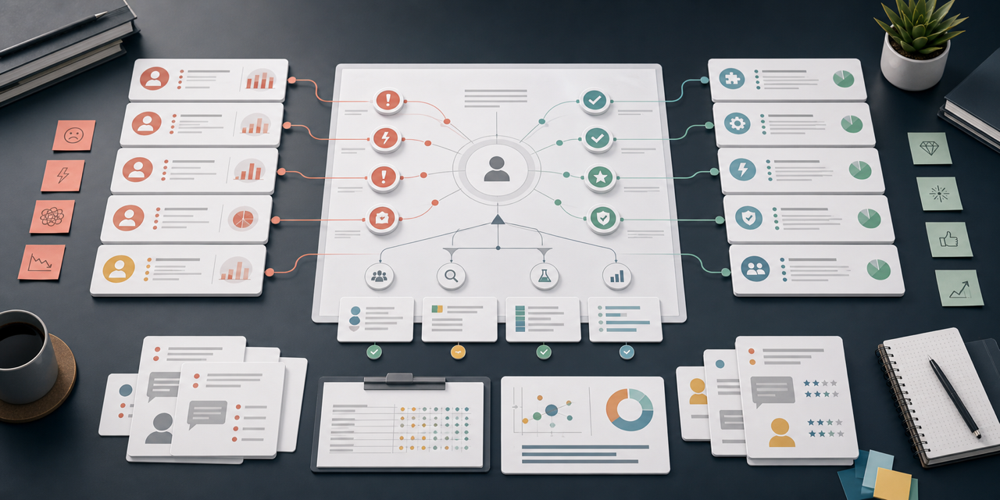

# Value Props & Pain Points Skill



This is an AI-agnostic research workflow for mapping product value propositions to user and customer pain points, evidence, archetypal motivations, and messaging opportunities.

The skill is portable across AI tools. Use it with ChatGPT, Claude, Gemini, Perplexity, Manus, Codex, Cursor, local models, browser-based research, note-taking systems, spreadsheets, or manual research.

## What It Helps With

- Identify and prioritize user and buyer pain points
- Connect each pain point to concrete product value propositions
- Separate user-level pains from ICP or buyer-level pains
- Map evidence strength, emotional drivers, and strategic messaging implications
- Turn messy research into a clear pain-to-value matrix

## Why It Exists

Research templates are useful, but assistants often fill them with plausible-sounding generalities unless they are forced to track evidence, assumptions, gaps, and strategic implications. This skill turns the source template into an operating workflow: gather the right inputs, structure the research, mark uncertainty, and produce an artifact that can guide real decisions.

## Repository Contents

```text
.
|-- SKILL.md
|-- README.md
|-- assets/
|   `-- value-props-pain-points-banner.png
|-- agents/
|   `-- openai.yaml
`-- references/
    `-- source-template.md
```

- `SKILL.md` is the installable skill.
- `references/source-template.md` preserves the original Nessie template that inspired the workflow.
- `agents/openai.yaml` is optional UI metadata for OpenAI/Codex-style skill surfaces.

## Quick Start

Give an assistant the contents of `SKILL.md`, then ask it to produce or improve the research artifact.

Example:

```text
Use the Value Props & Pain Points skill to turn the notes below into a clear, evidence-backed research artifact. Mark assumptions and gaps instead of inventing facts.
```

For tools that support skill folders, install or copy this folder into the tool's skills directory and invoke:

```text
Use $value-props-pain-points to map this product's value propositions to customer pain points.
```

## Recommended Process

1. Clarify the product, audience, market, and decision the research should support.
2. Gather supplied material and current external sources when available.
3. Separate evidence from assumptions.
4. Draft the research artifact using the skill's output sections.
5. Audit the artifact for unsupported claims, vague categories, stale data, and missing next steps.

## GitHub Description

AI-agnostic research skill for mapping customer pain points to product value propositions and strategic messaging.

## Suggested GitHub Topics

`ai`, `ai-agents`, `research`, `market-research`, `customer-research`, `value-proposition`, `pain-points`, `positioning`, `messaging`, `product-strategy`, `customer-development`, `persona`, `icp`, `prompt-engineering`, `ai-skills`

## Source Inspiration

This package was created from the shared Nessie context [Value Props & Pain Points Analysis](https://nessielabs.com/context/a2c256b0-55fd-4033-9642-40818a080015), then rewritten as portable, AI-agnostic agent instructions.

## License

No license has been selected yet. Add a license before encouraging broad downstream reuse or redistribution.
