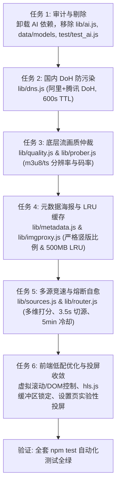

# Implementation Plan: 影悦工业级可靠稳定与极致体验重构 (004-mature-reliable-core)

## 1. 架构与改动概览

## 2. 涉及模块与详细改造点

### 2.1 依赖剔除与 IPC 脱脂
- 删除 `lib/ai.js`、`test/test_ai.js`、`data/models/`、`data/vector_cache.json`。
- 清理 `main.js` 与 `preload.js` 中 `ai:` 冗余 IPC 监听。
- 修改 `package.json` 中的 `test` 指令，剔除 `node test/test_ai.js`。
- 更新 `test/test_user_fixes.js` 中关于 `ai.js` 的旧断言，对齐工业级纯净无依赖架构。

### 2.2 投屏入口收敛与按需开启
- 修改 `lib/cast.js` / `main.js`：默认不启动后台 WebCast HTTP 串流服务器，按需启用。
- 修改 `src/app.js`：
  - 在 `store.settings` 增加 `enableCast: false` 配置。
  - 在 `renderSettings` 增加「实验性功能」面板与投屏开关。
  - 在播放器控制栏根据 `enableCast` 开关条件显示 `#btnCast`，未开启时隐藏。

### 2.3 前端低配设备流畅度与虚拟视口
- 卡片网格采用基于视口的轻量虚拟化/分批加载，控制同屏 DOM 节点总数 ≤ 60。
- `hls.js` 缓冲区参数降级锁定：
  - `maxBufferLength: 30`
  - `maxMaxBufferLength: 60`
  - `backBufferLength: 10`
  - `lowLatencyMode: false`

### 2.4 自动化验证与质量门禁
- 运行 `node scripts/audit-domains.js` 确保 100% 域名合规。
- 运行 `npm test` 保证所有模块测试全绿。

