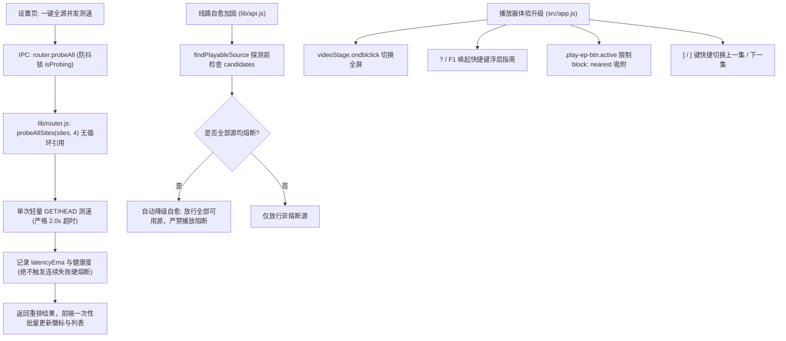

# Implementation Plan: 片源智能并发测速与播放器体验深度优化 (005-router-player-refine)

## 1. 架构方案与模块设计 (Post-EGM Revision)

## 2. 详细改造点

### 2.1 后端测速与自适应路由 (`lib/router.js`, `lib/api.js`, `main.js`, `preload.js`)
- `lib/router.js`：
  - 实现纯原生轻量探针 `probeSite(site, timeoutMs = 2000)`，仅测 HTTP 连通与响应时延，**严禁顶层 require `lib/api.js`**。
  - 实现 `probeAllSites(sites, { concurrency = 4, timeoutMs = 2000 } = {})`，滑动池控制最多 4 路并发。
  - 测速仅更新 `latencyEma` 与 `lastTested`，不累加 `consecutiveFailures`，杜绝离线测速导致全站硬熔断。
- `lib/api.js`：
  - 加固 `findPlayableSource`：当非熔断源数量为 0 时，自动降级解除熔断限制，兜底尝试所有启用源。
- `main.js` & `preload.js`：
  - 注册 `router:probeAll`，维护主进程 `isProbing` 标志位防止重复触发。
  - `preload.js` 暴露 `router.probeAll()`。

### 2.2 前端测速视图 (`src/app.js`, `src/app.css`)
- `src/app.js` 设置页：
  - 增加 `#btnProbeAllSources`（一键全源测速）与测速进行中 loading 态。
  - 测速完成后根据时延显示 `${ms}ms` 并按健康度重排。
- `src/app.css`：
  - 增加 `.badge-speed`（fast / medium / slow / down 状态色）与快捷键弹窗样式。

### 2.3 播放器交互与快捷键 (`src/app.js`)
- 画面双击全屏：在 `videoStage` 绑定 `ondblclick`。
- 选集吸附：播放器加载与换集时，`currentActiveEp.scrollIntoView({ block: 'nearest', inline: 'center', behavior: 'smooth' })`。
- 快捷键帮助弹窗：新增 `renderShortcutModal()`，绑定 `?` (Shift+/) 与 `F1` 键打开/关闭。
- 快捷切集：监听 `[` 切换上一集，`]` 切换下一集。

### 2.4 自动化验证与质量门禁 (`test/test_sources.js`, `test/test_user_fixes.js`)
- `test/test_sources.js`：增加测试项断言 `probeAllSites` 4 路并发、超时快速返回、全熔断自愈兜底机制。
- `test/test_user_fixes.js`：增加对双击全屏、快捷键弹窗、`[` 与 `]` 切集快捷键的断言。
- 运行 `npm test` 保证全套测试通过。
